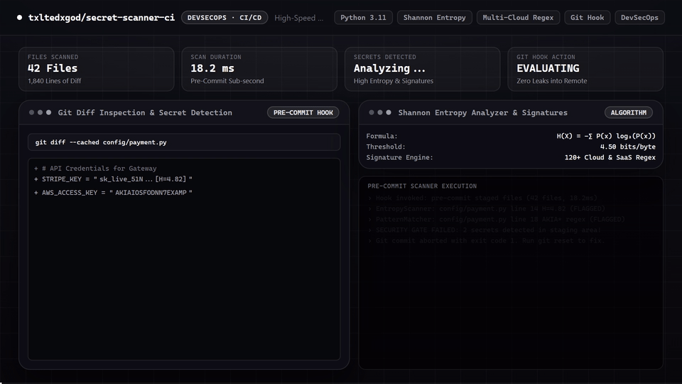
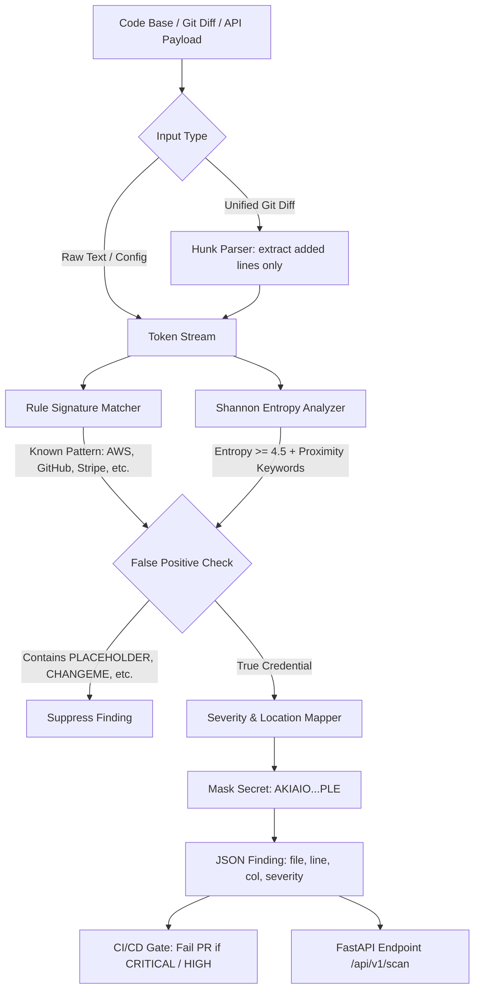

# 🔐 Secret Scanner CI

[](https://github.com/txltedxgod/secret-scanner-ci/actions/workflows/ci.yml)
[](https://opensource.org/licenses/MIT)
[](https://www.python.org/)
[](https://fastapi.tiangolo.com/)
[](#architecture)
[](https://pre-commit.com/)

High-speed DevSecOps pre-commit and CI/CD secret scanner. Detects leaked API keys, tokens, cryptographic private keys, and high-entropy credentials in source code and Git diffs using Shannon entropy analysis and regex signatures.

---

## 🎬 Feature Demo

<p align="center">
  
</p>
<p align="center">
  <sub><a href="assets/demo.mp4">Watch / Download 1080p60 MP4</a></sub>
</p>

---
---

## 🏛️ Detection Pipeline & Architecture



---

## ✨ Key Features

- **Multi-Cloud & SaaS Signature Library**: Pre-configured high-precision regex signatures for AWS Access Keys, AWS Secret Keys, GitHub PATs (`ghp_`, `gho_`), GitLab Tokens (`glpat-`), Stripe Live Keys (`sk_live_`), Slack Tokens (`xoxb-`), OpenAI (`sk-`), Anthropic (`sk-ant-`), JWTs, and PEM Private Keys.
- **Shannon Entropy Analysis**: Mathematical entropy calculation ($-\sum p \log_2 p$) detects unformatted high-randomness passwords and secret strings when correlated with credential keywords.
- **Git Diff Scanner**: Efficiently parses unified Git diffs (e.g. `git diff HEAD~1`) to scan only newly added lines (`+`), completely ignoring removed lines (`-`).
- **Contextual Line & Column Mapping**: Pinpoints exact 1-based line and column coordinates of every leak.
- **False-Positive Suppression**: Automatically ignores documentation placeholders (`YOUR_KEY`, `CHANGEME`, `PLACEHOLDER`).
- **Safe Masked Output**: Never leaks cleartext secrets in logs or CI output (e.g. `AKIAIO...`).

---

## 🚀 Quickstart

### Local Installation

```bash
git clone https://github.com/txltedxgod/secret-scanner-ci.git
cd secret-scanner-ci

python -m venv .venv
source .venv/bin/activate  # On Windows: .venv\Scripts\activate
pip install -r requirements.txt
```

### Run Tests

```bash
pytest -v tests/
```

### Start REST API Server

```bash
uvicorn scanner.api:app --host 0.0.0.0 --port 8000 --reload
```

---

## 📡 REST API Reference

### 1. Scan Raw Content
`POST /api/v1/scan`

**Request Payload:**
```json
{
  "content": "export GITHUB_TOKEN='ghp_REDACTED_EXAMPLE_TOKEN_FOR_DOCS_XYZ'"
}
```

**Response (200 OK):**
```json
{
  "has_secrets": true,
  "total_findings": 1,
  "findings": [
    {
      "rule": "GitHub Token",
      "rule_id": "SEC003",
      "severity": "CRITICAL",
      "matched": "ghp_AB...",
      "start": 21,
      "end": 63,
      "line": 1,
      "column": 22,
      "entropy": 4.86
    }
  ]
}
```

### 2. Scan Staged Git Diff
`POST /api/v1/scan/diff`

Inspects additions across pull requests or pre-commit hooks, mapping findings back to their respective filenames and line numbers.

---

## 🛡️ License

MIT License. See [LICENSE](LICENSE) for details.
